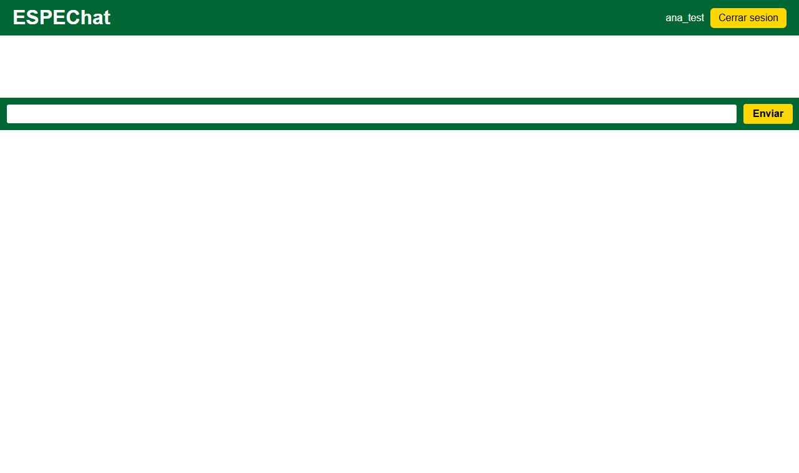
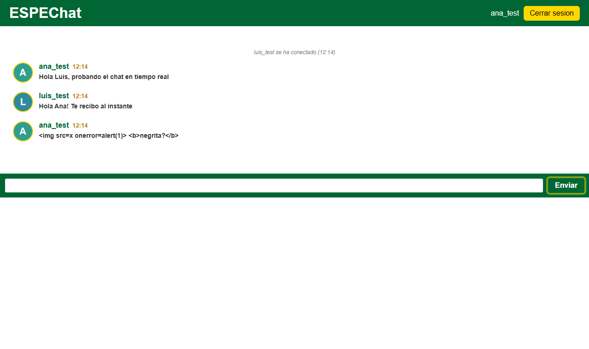
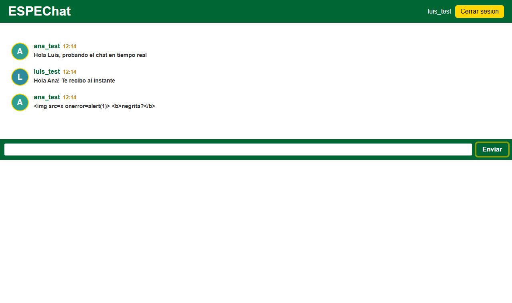
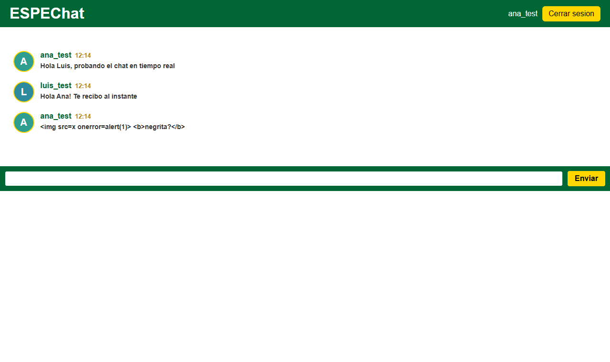
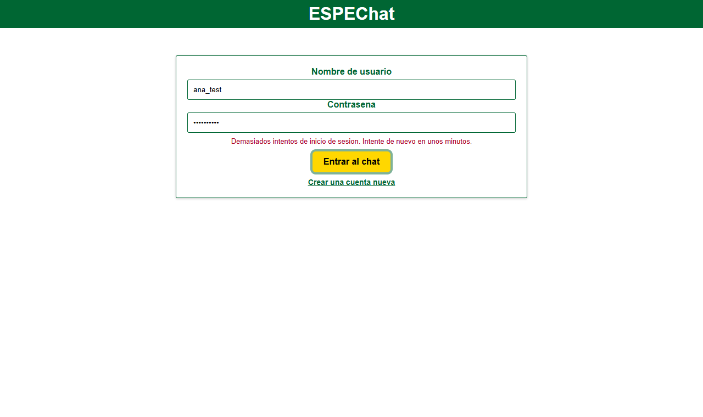
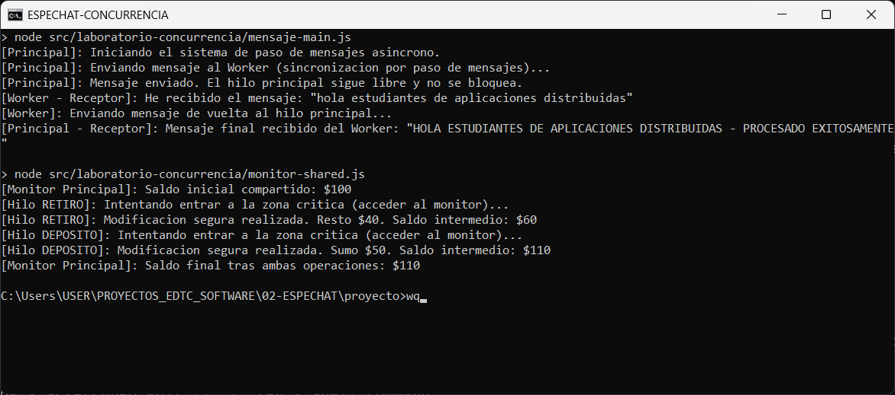
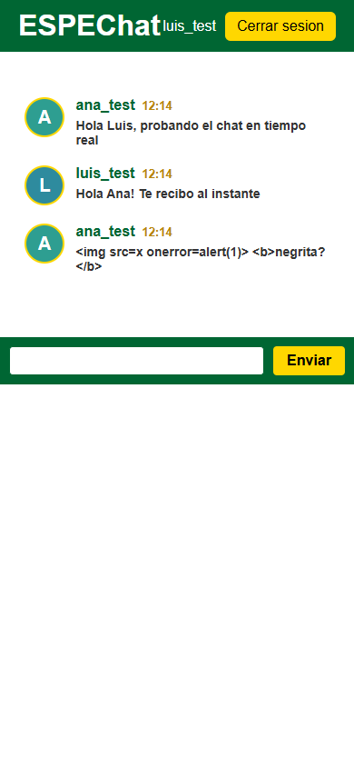
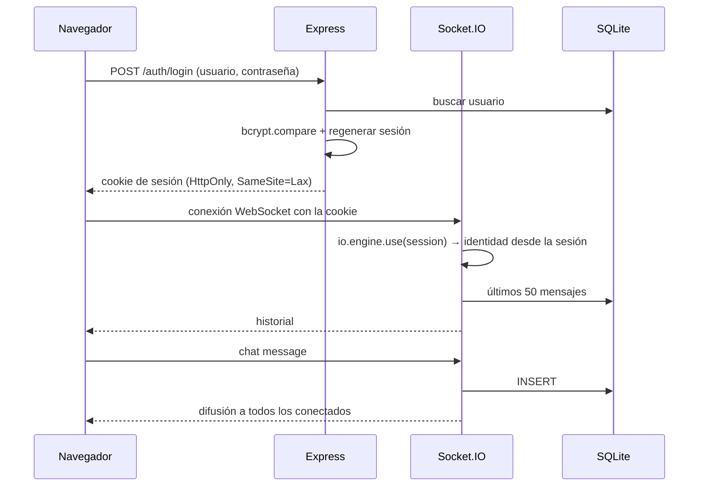
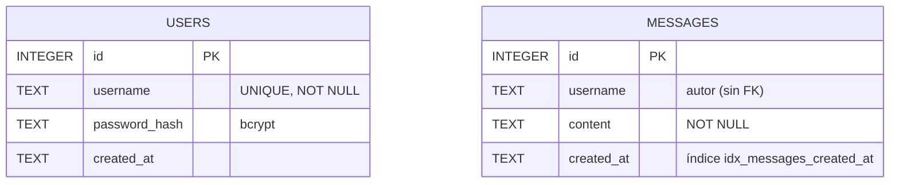
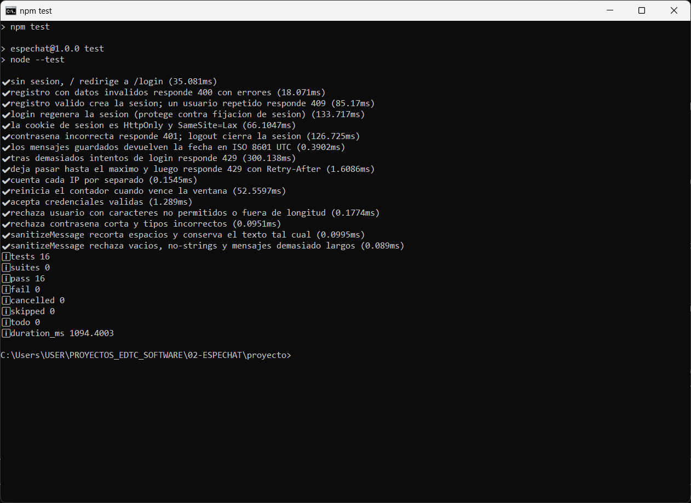

# ESPEChat · chat en tiempo real con Node.js y Socket.IO

Sala de chat web en tiempo real con cuentas de usuario, sesiones compartidas entre HTTP y WebSockets, historial persistente en SQLite y un laboratorio de concurrencia con `worker_threads`.

     

| | |
|---|---|
| **Problema** | Comunicar a varios usuarios al instante sin recargar la página ni consultar al servidor de forma repetida (*polling*) |
| **Objetivo** | Un chat autenticado en el que la identidad del usuario en el WebSocket provenga de la misma sesión validada por HTTP, con mensajes persistentes y protección frente a ataques comunes |
| **Estado** | ✅ Funcional. 16/16 pruebas (2026-10-28) y 13/13 comprobaciones E2E con dos usuarios en Chrome (2026-10-07) |
| **Autor** | Edgar Damian Toscano Coro · Estudiante de Ingeniería de Software · Universidad de las Fuerzas Armadas ESPE |
| **Origen** | Desarrollado sobre un clon del proyecto [paulosk8/espechat](https://github.com/paulosk8/espechat) de **Paulo Galarza**. Ver [Autoría y créditos](#autoría-y-créditos) |

## Contenido

[Capturas](#capturas) · [Funcionalidades](#funcionalidades) · [Tecnologías](#tecnologías) · [Arquitectura](#arquitectura) · [Modelo de datos](#modelo-de-datos) · [Seguridad](#seguridad) · [Instalación](#instalación-y-ejecución-local) · [Pruebas](#pruebas-y-validación) · [Limitaciones](#limitaciones-y-mejoras-futuras) · [Autoría](#autoría-y-créditos)

## Capturas

Capturas reales con dos cuentas de prueba (`ana_test`, `luis`) conectadas a la vez.

| Registro y entrada al chat | Conversación en vivo entre dos usuarios |
|---|---|
|  |  |

| Un mensaje con HTML se muestra como texto | Historial con la hora local correcta |
|---|---|
|  |  |

| Inicio de sesión bloqueado tras demasiados intentos | Laboratorio de concurrencia |
|---|---|
|  |  |



## Funcionalidades

| Funcionalidad | Cómo se usa | Resultado | Restricciones |
|---|---|---|---|
| Registro | `/register` | Crea la cuenta e inicia sesión | Usuario de 3 a 20 caracteres (`a-z`, `0-9`, `_`), único; contraseña de 6 caracteres como mínimo |
| Inicio y cierre de sesión | `/login` y botón *Cerrar sesión* | Sesión de servidor con cookie | 10 intentos por IP cada 15 minutos (después responde 429) |
| Chat en tiempo real | Escribir y pulsar *Enviar* o Enter | El mensaje llega al instante a todos los conectados | Máximo 500 caracteres; una sola sala global |
| Historial | Automático al entrar | Últimos 50 mensajes guardados | Sin paginación |
| Avisos de conexión | Automático | Se informa cuando alguien entra o sale | — |
| Hora local | Automático | El servidor envía ISO 8601 UTC y cada navegador lo muestra en su zona horaria | — |
| Laboratorio de concurrencia | `node src/laboratorio-concurrencia/…` | Paso de mensajes entre hilos y exclusión mutua con `SharedArrayBuffer` + `Atomics` | Módulo independiente del servidor web |

**No implementado:** salas múltiples, mensajes privados, envío de archivos y despliegue público.

## Tecnologías

| Categoría | Tecnología | Uso |
|---|---|---|
| Lenguaje y entorno | JavaScript, Node.js ≥ 20 | Servidor y cliente |
| Backend | Express 5 | Rutas HTTP y archivos estáticos |
| Tiempo real | Socket.IO 4 | WebSockets con reconexión |
| Sesiones | express-session, cookie-parser | Sesión de servidor compartida con Socket.IO |
| Base de datos | SQLite mediante better-sqlite3 | Usuarios y mensajes |
| Seguridad | bcryptjs | Hash de contraseñas (asíncrono) |
| Configuración | dotenv | Variables de entorno |
| Frontend | HTML, CSS y JavaScript sin frameworks | Interfaz del chat |
| Pruebas | `node:test` (integrado en Node) | Pruebas unitarias e integración HTTP |
| Desarrollo | nodemon | Recarga automática |

## Arquitectura

```
espechat/
├── src/
│   ├── app.js                    Construye Express + Socket.IO sin escuchar (permite probarlo)
│   ├── index.js                  Punto de entrada: arranca el servidor
│   ├── config/                   env.js (variables), session.js (cookie y sesión)
│   ├── db/                       connection.js (SQLite), schema.js (tablas)
│   ├── models/                   userModel.js, messageModel.js (consultas preparadas)
│   ├── controllers/              authController.js (registro, login, logout)
│   ├── middleware/               isLoggedIn, isLoggedOut, rateLimit, errorHandler
│   ├── routes/index.js           Rutas HTTP
│   ├── sockets/chatSocket.js     Eventos del chat y autenticación del socket
│   ├── utils/validation.js       Validaciones puras compartidas
│   ├── views/                    index, login, register, 404 (HTML)
│   ├── public/                   CSS y JavaScript del cliente
│   └── laboratorio-concurrencia/ worker_threads, SharedArrayBuffer, Atomics
├── test/                         validation, rateLimit, integración HTTP
└── docs/screenshots/
```



La identidad en el chat **no se lee de una cookie manipulable**: Socket.IO reutiliza el middleware de sesión de Express (`io.engine.use`), así que un socket solo existe para un usuario autenticado.

## Modelo de datos

**SGBD:** SQLite (archivo `data/espechat.db`, que se crea solo al arrancar). El esquema está en `src/db/schema.js`.



`messages.username` guarda el nombre del autor como texto; **no hay clave foránea** declarada hacia `users`. Las sesiones se guardan en memoria (`MemoryStore`), no en la base de datos.

## Seguridad

### Medidas implementadas y comprobadas

| Riesgo | Medida | Comprobación |
|---|---|---|
| Contraseñas en claro | Hash bcrypt (bcryptjs, asíncrono) | Pruebas de integración |
| Suplantación en el chat | Identidad del socket tomada de la sesión de servidor | E2E con dos usuarios |
| Fijación de sesión | La sesión se regenera al iniciar sesión | Prueba de integración |
| Robo de cookie por JavaScript / CSRF básico | Cookie `HttpOnly`, `SameSite=Lax`, `Secure` en producción, caducidad de 8 h | Revisión de `config/session.js` |
| Fuerza bruta | 10 intentos de login o registro por IP cada 15 min → 429 | Prueba de integración + captura 5 |
| XSS | Los mensajes se insertan con `textContent`, nunca como HTML | E2E (captura 3) |
| Inyección SQL | Consultas preparadas de better-sqlite3 | Revisión de `models/` |
| Secretos | `SESSION_SECRET` desde `.env`; obligatorio con `NODE_ENV=production`; `.env` y `data/` ignorados por Git | Revisión |
| Dependencias | `npm audit`: 0 vulnerabilidades tras actualizar dependencias transitivas dentro de sus rangos (2026-10-28) | `npm audit` |

### Riesgos y recomendaciones pendientes

- El límite de intentos se guarda en memoria y es por IP: se reinicia con el servidor y no sirve detrás de un proxy sin configurar `trust proxy`.
- `MemoryStore` no es apto para producción (pierde sesiones al reiniciar y no escala). Se recomienda un *store* persistente.
- No hay token CSRF explícito en los formularios (se depende de `SameSite=Lax`).
- No hay moderación ni límite de frecuencia en los mensajes del chat.

## Instalación y ejecución local

**Requisitos:** Node.js 20 o superior. No hace falta compilador: `better-sqlite3` descarga un binario precompilado.

```bash
npm ci                    # instala las versiones exactas de package-lock.json
cp .env.example .env      # en Windows: copy .env.example .env
npm run dev               # desarrollo, con recarga automática
# o
npm start                 # ejecución normal
```

Abrir <http://localhost:3000>, crear una cuenta en `/register` y abrir una segunda ventana (o un navegador en modo incógnito) con otra cuenta para ver el tiempo real.

| Variable | Descripción | Valor por defecto |
|---|---|---|
| `PORT` | Puerto HTTP | `3000` |
| `SESSION_SECRET` | Firma de la cookie de sesión | Obligatoria si `NODE_ENV=production` |
| `NODE_ENV` | `development` o `production` | `development` |
| `DB_PATH` | Archivo SQLite (`:memory:` = temporal) | `data/espechat.db` |

**Laboratorio de concurrencia** (independiente del servidor):

```bash
node src/laboratorio-concurrencia/mensaje-main.js
node src/laboratorio-concurrencia/monitor-shared.js
```

| Problema | Solución |
|---|---|
| `EADDRINUSE` | El puerto 3000 está ocupado: definir otro `PORT` |
| El servidor no arranca en producción | Falta `SESSION_SECRET` |
| «Demasiados intentos» | Esperar 15 minutos o reiniciar el servidor |

## Pruebas y validación

| Tipo | Qué se probó | Comando | Resultado |
|---|---|---|---|
| Unitarias | Validación de usuario, contraseña y mensaje; limitador de intentos | `npm test` | ✅ |
| Integración HTTP (base en memoria) | Registro, duplicados, login, regeneración de sesión, logout, límite de intentos, formato de fechas | `npm test` | ✅ |
| **Total** | | `npm test` | ✅ **16/16** (2026-10-28) |
| E2E en Chrome | Dos usuarios simultáneos: registro, chat, XSS, historial, hora local, límite de intentos, vista móvil, laboratorio | Manual guiada | ✅ **13/13** (2026-10-07) |



**No hay pruebas automatizadas de los eventos de Socket.IO.** Se comprobaron solo en la verificación E2E.

## Limitaciones y mejoras futuras

- Pruebas automatizadas de los eventos de Socket.IO.
- Store de sesiones persistente y limitador de intentos compartido.
- Varias salas y paginación del historial.
- Clave foránea de `messages` hacia `users`.
- Despliegue público (Render, Railway u otro) para tener una demo en línea.

## Autoría y créditos

**Desarrollador: Edgar Damian Toscano Coro**
Estudiante de Ingeniería de Software
Universidad de las Fuerzas Armadas ESPE

| Etapa | Autor | Contenido |
|---|---|---|
| Versión original | **Paulo Galarza** ([paulosk8/espechat](https://github.com/paulosk8/espechat)) | Chat básico con Socket.IO; el nombre se tomaba de una cookie, sin contraseña ni base de datos |
| Desarrollo sobre el clon | **Edgar Damian Toscano Coro** | Arquitectura por capas; registro y login con bcrypt; sesiones compartidas HTTP/Socket.IO; SQLite con historial; validaciones; protección XSS; páginas de login y 404; manejo de errores; configuración por `.env`; laboratorio de concurrencia |
| Revisión (octubre de 2026) | Edgar Damian Toscano Coro, con asistencia de IA (Claude Code) | Instalación sin compilador, corrección de la hora, regeneración de sesión, límite de intentos, bcrypt asíncrono, avatares con inicial, 16 pruebas y actualización de dependencias |

Se publica con autorización del autor original. Se conserva la licencia **ISC** declarada en el proyecto original. Ver [LICENSE](LICENSE).
